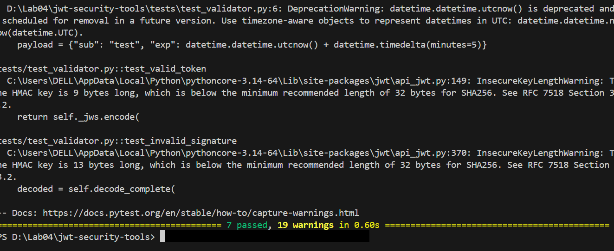
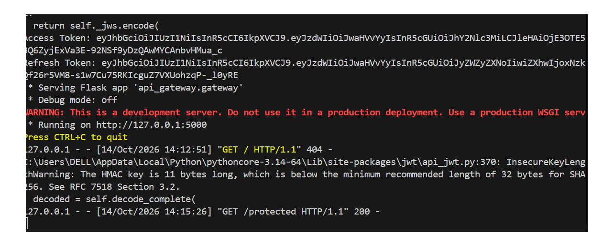
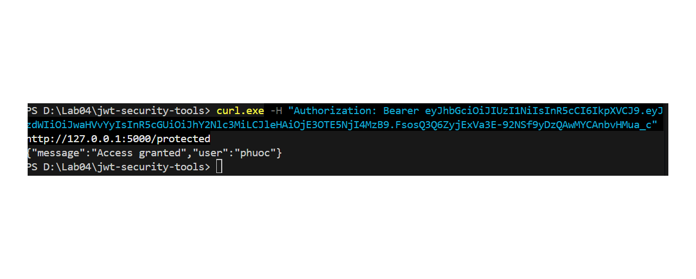

Phân tích Dự án JWT Security Tools

Tài liệu này cung cấp báo cáo phân tích và minh họa kết quả chạy thử nghiệm (testing) cũng như quá trình vận hành của các công cụ bảo mật JWT (jwt-security-tools). Các hình ảnh minh họa được lưu trữ trong thư mục images/ tương ứng với từng giai đoạn kiểm thử.

1. Chạy Unit Test và Kiểm tra Xác thực Token (test_validator.py)

Dưới đây là kết quả thực thi các bài kiểm thử tự động bằng pytest đối với module xác thực JWT:

Phân tích chi tiết:

Kết quả Test: Có tổng cộng 7 passed (7 bài kiểm thử đã vượt qua), chứng minh rằng logic xác thực token (test_validator.py) đang hoạt động chính xác theo kịch bản đề ra.

Cảnh báo Deprecation (DeprecationWarning):

Hàm datetime.datetime.utcnow() hiện đã lỗi thời và có kế hoạch loại bỏ trong các phiên bản Python tương lai.

Khuyến nghị: Nên chuyển sang sử dụng các đối tượng nhận biết múi giờ với datetime.now(datetime.UTC).

Cảnh báo Khóa Không Đủ Độ Dài (InsecureKeyLengthWarning):

Hệ thống phát hiện khóa HMAC được cấu hình có độ dài ngắn (9 byte hoặc 13 byte), thấp hơn mức khuyến nghị tối thiểu là 32 bytes (256 bits) cho thuật toán HS256 theo chuẩn RFC 7518 (Section 3.2).

Khuyến nghị: Cần tăng độ dài khóa bí mật (secret key) lên ít nhất 256 bits để chống lại các cuộc tấn công brute-force.

2. Khởi động Flask Server và Cấp phát Token

Hình ảnh dưới đây minh họa quá trình khởi động máy chủ Flask, phát hành Access Token/Refresh Token và ghi lại nhật ký request:

Phân tích chi tiết:

Cấp phát Token: Hệ thống tạo thành công Access Token và Refresh Token dạng chuỗi JWT tiêu chuẩn (eyJhbGciOi...).

Trạng thái Server: Ứng dụng chạy trên môi trường phát triển cục bộ (http://127.0.0.1:5000) với chế độ Debug mode: off.

Cảnh báo Môi trường: Server cảnh báo đây là máy chủ phát triển (development server) và không dùng cho môi trường production. Thay vào đó, cần dùng WSGI server chuyên dụng (như Gunicorn, uWSGI).

Nhật ký truy cập (Request Log):

Yêu cầu GET / trả về mã lỗi 404.

Tiếp tục xuất hiện cảnh báo InsecureKeyLengthWarning khi server tiến hành giải mã token.

Yêu cầu GET /protected phản hồi thành công với mã trạng thái 200.

3. Kiểm thử API được Bảo vệ bằng cURL

Hình ảnh dưới đây thể hiện kết quả kiểm tra endpoint được bảo mật khi gửi kèm JWT thông qua header Authorization: Bearer:

Phân tích chi tiết:

Gửi Request: Lệnh curl.exe được sử dụng để gửi yêu cầu HTTP kèm theo header xác thực chứa JWT Bearer Token:

curl.exe -H "Authorization: Bearer <JWT_TOKEN>" http://127.0.0.1:5000/protected

Phản hồi từ Server: Server tiếp nhận token, giải mã/xác thực thành công và trả về dữ liệu JSON:

{"message": "Access granted", "user": "phuoc"}

Kết luận: Cơ chế phân quyền dựa trên JWT hoạt động đúng đắn, cho phép người dùng có token hợp lệ truy cập vào tài nguyên bảo mật và xác thực chính danh tính người dùng (phuoc).

Tổng kết & Hướng khắc phục bảo mật

Cập nhật mã nguồn: Thay thế các hàm thời gian utcnow() cũ thành now(timezone.utc).

Tăng cường độ mạnh Khóa Bí Mật: Nâng cấp độ dài của khóa HMAC lên $\ge 32$ byte để loại bỏ hoàn toàn cảnh báo InsecureKeyLengthWarning.

Môi trường Production: Triển khai ứng dụng thông qua WSGI server thay vì dùng Flask dev server.