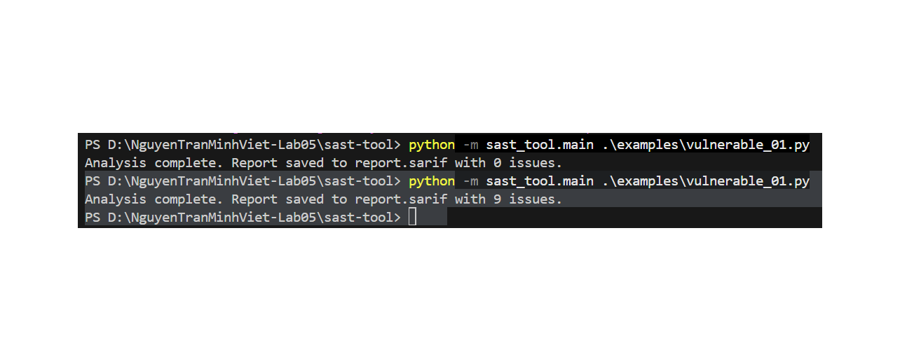
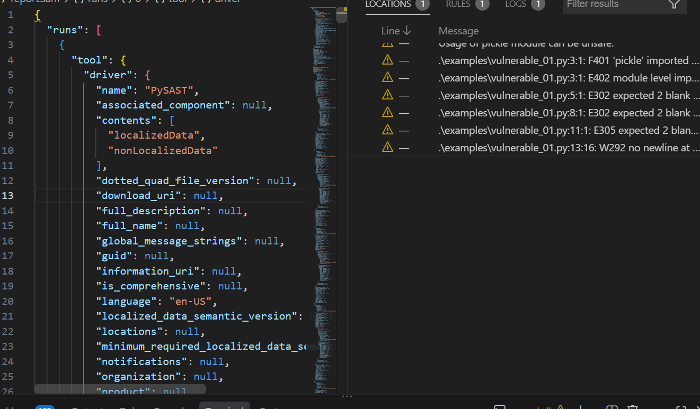
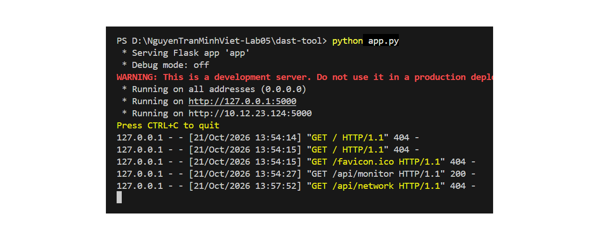
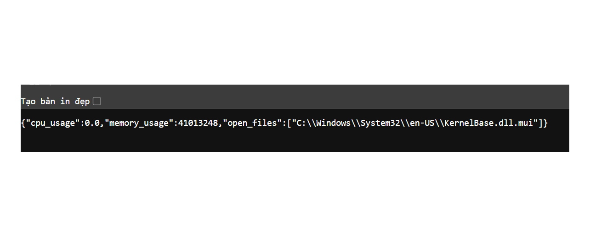

# Phân tích Báo cáo Thực hành Công cụ Bảo mật SAST & DAST

Tài liệu này cung cấp báo cáo phân tích chi tiết và minh họa kết quả chạy thử nghiệm (testing) cũng như quá trình vận hành của các công cụ phân tích tĩnh (SAST - Static Application Security Testing) và phân tích động (DAST - Dynamic Application Security Testing) trong hệ thống `NguyenTranMinhViet-Lab05`.

---

## 1. Phân tích Tĩnh Code Cấu trúc Bảo mật (SAST Tool)

Hình ảnh dưới đây minh họa quá trình thực thi công cụ SAST (`sast_tool.main`) trên tệp mã nguồn mẫu `.\examples\vulnerable_01.py`:



### Phân tích chi tiết:
* **Lần chạy thứ nhất (`python -m sast_tool.main .\examples\vulnerable_01.py`):**
  * Công cụ hoàn tất phân tích và xuất báo cáo ra tệp `report.sarif` với **0 lỗ hổng** (`0 issues`).
* **Lần chạy thứ hai (`python -m sast_tool.main .\examples\vulnerable_01.py`):**
  * Sau khi kích hoạt/cập nhật bộ quy tắc phân tích (bao gồm các quy tắc mã nguồn và kiểm tra chuẩn PEP8/Linter), công cụ phát hiện tổng cộng **9 lỗ hổng/cảnh báo** (`9 issues`).
* **Định dạng báo cáo SARIF:** 
  * Kết quả được tự động đóng gói theo chuẩn quốc tế **SARIF** (Static Analysis Results Interchange Format), giúp dễ dàng tích hợp vào các đường ống CI/CD hoặc các công cụ quản lý lỗ hổng bảo mật tập trung.

---

## 2. Kiểm tra Chi tiết Cảnh báo & Định dạng Báo cáo SARIF

Hình ảnh dưới đây hiển thị cấu trúc tệp báo cáo `report.sarif` và danh sách chi tiết các cảnh báo được ghi nhận trong VS Code:



### Phân tích chi tiết:
* **Cấu trúc Báo cáo SARIF (bên trái):**
  * Tệp định dạng JSON chứa các trường tiêu chuẩn như `runs`, `tool`, `driver` với tên công cụ phân tích là **PySAST**.
  * Cấu hình ngôn ngữ báo cáo là `en-US` và lưu trữ siêu dữ liệu đầy đủ về quá trình quét mã nguồn.
* **Danh sách Cảnh báo & Lỗi bảo mật (bên phải - cửa sổ Problems):**
  * **Cảnh báo Bảo mật (Security Warning):** Phát hiện việc sử dụng thư viện không an toàn: `Usage of pickle module can be unsafe` tại tệp `vulnerable_01.py`. Việc deserialize dữ liệu từ thư viện `pickle` chứa rủi ro bị tấn công RCE (Remote Code Execution).
  * **Lỗi Tuân thủ Mã nguồn (Code Style / Linter):** Các lỗi chuẩn mã nguồn Flake8/PEP8 như tệp chưa import đúng cách (`F401 'pickle' imported...`, `E402 module level import...`), thiếu dòng trống (`E302`, `E305`), và thiếu ký tự xuống dòng ở cuối tệp (`W292`).

---

## 3. Khởi động Flask Application & Giám sát Truy cập (DAST Target)

Hình ảnh dưới đây minh họa quá trình khởi động máy chủ Flask trong ứng dụng DAST (`dast-tool/app.py`) và nhật ký ghi lại các yêu cầu HTTP gửi đến server:



### Phân tích chi tiết:
* **Khởi động Server:**
  * Ứng dụng Flask chạy ở môi trường cục bộ trên tất cả các giao diện mạng (`0.0.0.0`) tại cổng `5000` (`http://127.0.0.1:5000` và `http://10.12.23.124:5000`).
* **Cảnh báo Môi trường (Development Warning):**
  * Hệ thống đưa ra cảnh báo đây là *development server* và khuyến cáo không sử dụng trực tiếp trên môi trường production.
* **Nhật ký truy cập (Request Logs):**
  * Đã ghi nhận các yêu cầu HTTP GET gửi tới các endpoint khác nhau:
    * `GET /`: Trả về mã lỗi `404 Not Found`.
    * `GET /favicon.ico`: Trả về mã lỗi `404 Not Found`.
    * `GET /api/monitor`: Phản hồi thành công với mã trạng thái `200 OK`.
    * `GET /api/network`: Trả về mã lỗi `404 Not Found`.

---

## 4. Kiểm thử Endpoint Giám sát Hệ thống (/api/monitor)

Hình ảnh dưới đây thể hiện dữ liệu JSON phản hồi từ endpoint `/api/monitor` khi thực hiện truy vấn DAST / API testing:



### Phân tích chi tiết:
* **Dữ liệu Phản hồi (JSON Response):**
  ```json
  {
    "cpu_usage": 0.0,
    "memory_usage": 41013248,
    "open_files": [
      "C:\\Windows\\System32\\en-US\\KernelBase.dll.mui"
    ]
  }
Đánh giá Lỗ hổng / Báo cáo Bảo mật:

Endpoint trả về thông tin giám sát tài nguyên hệ thống (Mức độ sử dụng CPU, RAM và các tệp đang mở).

Rủi ro rò rỉ thông tin (Information Disclosure): Việc công khai danh sách các tệp hệ thống đang mở (open_files) như C:\Windows\System32\en-US\KernelBase.dll.mui có thể cung cấp thông tin cấu hình nội bộ chi tiết cho kẻ tấn công thực hiện bước thu thập thông tin (Reconnaissance).

Tổng kết & Hướng khắc phục bảo mật
Đối với công cụ SAST (Mã nguồn):

Thay thế thư viện không an toàn: Tránh sử dụng pickle để unpickle dữ liệu từ các nguồn không tin tưởng. Thay thế bằng các định dạng an toàn hơn như json hoặc yaml (với SafeLoader).

Chuẩn hóa Code Style: Chỉnh sửa tệp theo tiêu chuẩn PEP8 (thêm dòng trống, loại bỏ import thừa, xử lý ký tự kết thúc dòng).

Đối với công cụ DAST & Server (Môi trường vận hành):

Kiểm soát thông tin nhạy cảm (Information Leakage): Ẩn hoặc hạn chế các chi tiết liên quan đến đường dẫn hệ thống nội bộ (open_files) trong phản hồi của API /api/monitor đối với người dùng thông thường.

Môi trường Production: Triển khai Flask App thông qua WSGI Server chuyên dụng (như Gunicorn, Waitress) thay vì chạy trực tiếp bằng Flask development server.